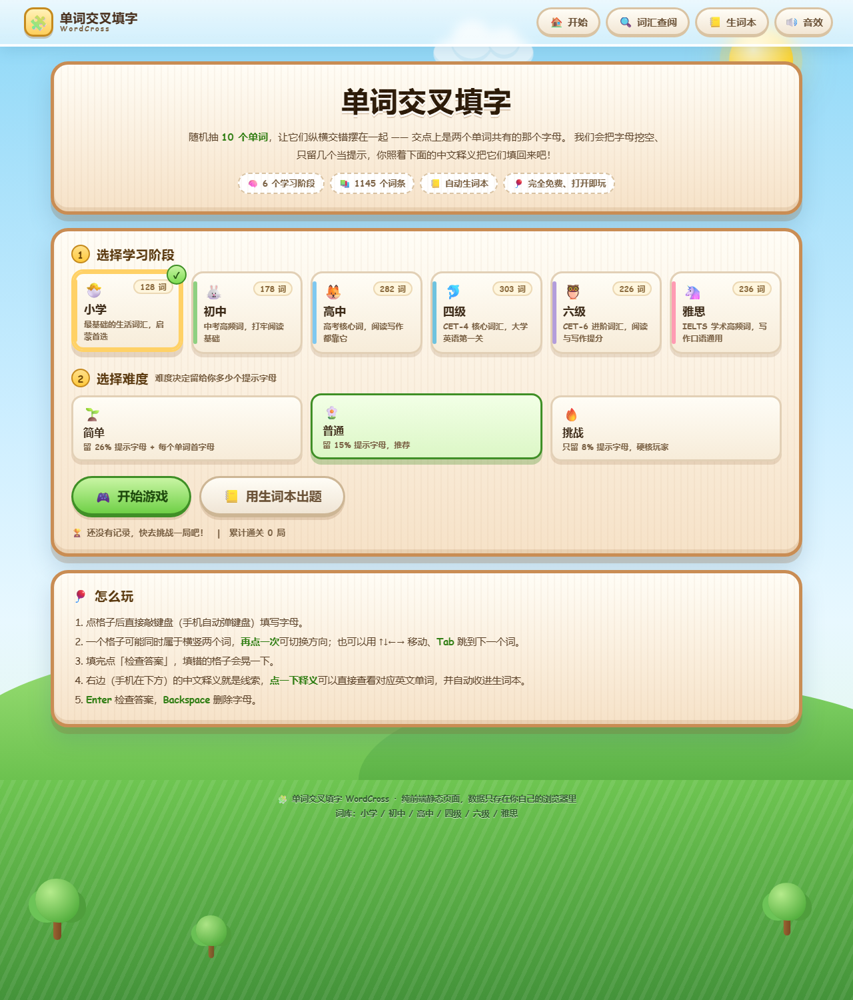
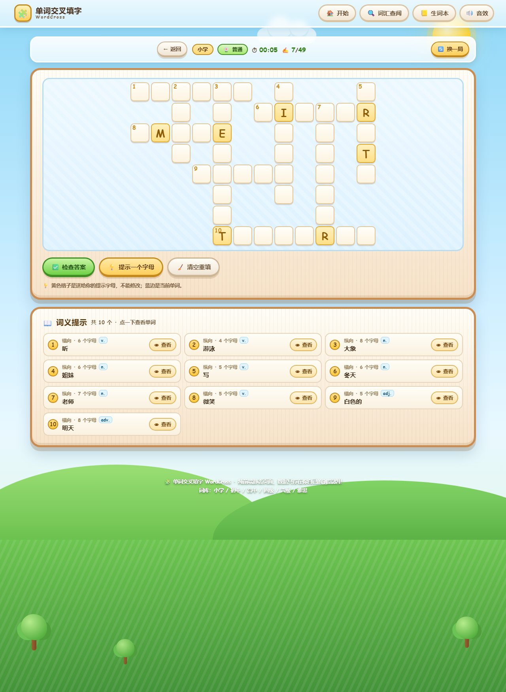

# 🧩 单词交叉填字 WordCross

一个用来**记单词**的网页小游戏：随机抽 **10 个单词**，让它们纵横交错地摆在同一张棋盘上 ——
**交点处必须是两个单词共有的那个字母**。单词的字母会被挖空，只留几个当提示，
玩家照着棋盘下方的**中文释义**把字母填回去。填不出来就点释义「查看」这个单词，
它会自动收进**生词本**，下次可以直接用生词本出题。

> 纯前端静态页面（原生 HTML + CSS + JavaScript，零依赖、零后端、零 API 调用）。
> 所有数据都存在浏览器本地，打开网页就能玩，**不消耗任何 AI 积分**，可以随便发给别人用。

🔗 **在线试玩：** <https://dai20080208.github.io/word--cross/>　·　备用地址 <https://word-cross-puzzle.app.workbuddy.host/>



## ✨ 功能一览

| 功能 | 说明 |
|---|---|
| 🔀 交叉填字 | 10 个单词随机纵横交错，交点字母自动对齐，摆不下会自动重排，保证 10 个词全部上盘 |
| 🕳 挖空留提示 | 全盘字母挖空，保留一小部分作为提示（优先保留交叉点，信息量最大） |
| 🎚 三档难度 | 简单留 26% 提示并额外送每个单词首字母 · 普通留 15% · 挑战只留 8% |
| 📖 中文释义在下方 | 棋盘下按序号列出 10 条释义，含词性、横向/纵向、字母数 |
| 👁 查看单词 | 点释义旁的「查看」，即时看到对应英文单词（棋盘上同步用浅色字母提示），并**自动收入生词本** |
| 📒 生词本 | 自动收藏 + 手动收藏，可朗读、移除、一键导出 CSV，词够多时还能**用生词本出题** |
| 🔍 词汇查阅 | 支持英文/中文双向模糊搜索，按学习阶段筛选 |
| 🎓 六个学习阶段 | 小学 · 初中 · 高中 · 四级 · 六级 · 雅思，共 **1934 个词条** |
| 🎨 卡通界面 | 蓝天白云、草地小树、木牌面板、圆润糖果按钮（照着 `reference/卡通界面参考.jpg` 的风格做的），手机端自适应 |
| 🔊 音效与朗读 | 按键、判定、过关都有 Web Audio 音效；英文单词调用系统语音朗读，可一键关闭 |
| 💾 本地存档 | 生词本、最佳成绩、音效开关存在 localStorage，刷新不丢 |



## 🎮 玩法与操作

1. **选阶段 → 选难度 → 点「开始游戏」**。
2. 点棋盘上任意格子（手机自动弹出键盘），直接敲字母填入。
3. 一个格子可能同时属于**横向**和**纵向**两个单词 —— **再点一次**同一个格子即可切换方向；
   当前单词的格子会显示浅蓝底，单词序号显示在该词的首格。
4. 填完点「检查答案」：填对的变绿，填错的变红并抖动。
   全部填满时会**自动判定**，直接弹出成绩单。
5. 卡住了点「💡 提示一个字母」；点释义旁的「👁 查看」可以直接看答案（会记进成绩）。

| 快捷键 | 作用 |
|---|---|
| `A` ~ `Z` | 填入字母并自动前进 |
| `Backspace` | 删除并回退一格 |
| `↑ ↓ ← →` | 在棋盘上移动（会自动切到该方向的单词） |
| `Tab` | 跳到下一个单词 |
| `Enter` | 检查答案 |
| `Esc` | 关闭弹窗 |

## 🚀 运行

不需要安装任何东西，**双击 `index.html` 就能玩**。

想用本地服务器（推荐，便于手机同局域网访问）：

```bash
# 任选一种
python -m http.server 8765
npx serve .
```

然后浏览器打开 <http://localhost:8765/>。

> 小技巧：链接末尾加上 `#play` 可以直接进入一局游戏，`#dict` / `#book` 分别是词汇查阅页和生词本页。

## 📁 项目结构

```
.
├── index.html              # 页面骨架（首页 / 游戏页 / 词汇查阅 / 生词本）
├── css/
│   └── style.css           # 全部样式：卡通背景（纯 CSS 画的蓝天、云、草地、小树）+ 组件
├── js/
│   ├── data/               # 词库（按阶段拆分，想加词改这里）
│   │   ├── primary.js      #   小学   300 词
│   │   ├── junior.js       #   初中   330 词
│   │   ├── senior.js       #   高中   370 词
│   │   ├── cet4.js         #   四级   400 词
│   │   ├── cet6.js         #   六级   360 词
│   │   └── ielts.js        #   雅思   390 词
│   ├── vocab.js            # 词库汇总 + 全局去重 + 搜索
│   ├── crossword.js        # ★ 交叉填字布局算法（核心）
│   ├── wordbook.js         # 生词本 / 成绩 / 音效开关（localStorage）
│   └── app.js              # 页面逻辑与交互
├── tools/
│   ├── selftest.js         # 算法与词库自测（node）
│   ├── uitest.js           # 端到端交互自测（node + jsdom）
│   ├── dict-stats.js       # 词库统计（各阶段词条数 / 重复 / 长度分布）
│   └── dump-words.js       # 导出已有单词清单（扩充词库时用来比对去重）
├── docs/                   # README 用的截图
├── reference/              # 界面风格参考图（老师给的卡通界面样例）
│   ├── 卡通界面参考.jpg
│   └── 卡通界面.pdf
└── README.md
```

## 🧠 核心算法（`js/crossword.js`）

生成一盘能玩的交叉填字，比想象中麻烦。程序做的事是这样的：

**① 选词** — 从选定阶段的词库里挑 10 个词（只挑 3~10 个字母的纯字母词）。
每挑一个新词时，优先挑**和已选单词字母重合多**的词，这样才容易交起来，同时加入随机扰动，保证每局都不一样。

**② 摆盘** — 先横放第一个词，之后每个词都尝试穿过已有单词的某个字母：

- 交点字母必须相同，且方向必须交叉（不能同向重叠）；
- 新字母的正交相邻格必须是空的 —— 否则会出现「两个单词并排紧贴却不相交」，读起来会串味；
- 单词首尾两端外侧也不能紧邻字母；
- 起点不能和别的单词起点重合，否则两个词会共用一个序号格，玩家会找不到另一个词的位置。

每个合法位置打分（`交点 × 14 − 棋盘扩张面积 × 0.45 − 长宽比惩罚 + 随机扰动`），在最高分附近的几个位置里随机挑一个，
让盘面既紧凑又不呆板。放不下的词先跳过，等别的词放好后回补；实在凑不满 10 个就从整个词库补位，整盘重来。

**③ 择优** — 一局会快速试上百次，最后挑**交点最多、格子最少、形状最方**的盘面，
所以每局平均有 12 个左右的交叉点，开局就有「纵横交错」的观感。

**④ 挖空与编号** — 按比例随机挖空（60% 的提示名额分配给交叉格），再按「从上到下、从左到右」给单词编号；
如果整盘比宽还高就整体旋转 90°，保证始终是横向的盘面。

**⑤ 自检** — 每次生成后都会跑一遍 `Crossword.validate()`，检查交点字母一致、无非法相邻、单词连续、无越界。
六个阶段各跑 25 局，**10 个单词全部摆下的成功率 100%**，单局耗时不到 15 毫秒。

## ✅ 自测

```bash
node tools/selftest.js      # 词库格式 + 布局算法
node tools/uitest.js        # 端到端交互（需要 npm i jsdom）
```

`uitest.js` 用 jsdom 真实加载页面并模拟玩家：选阶段 → 开局 → 点释义查看单词 → 敲键盘填满整盘 →
自动判定过关 → 再验证难度差异、词汇查阅、生词本、CSV 导出、用生词本出题等 39 项断言。

实测输出（六阶段各 25 局）：

```
  小学   词条 300  可入棋盘 299  10 词全放 100%  字母格 36~59（均 46.3）  平均交点 10.5
  初中   词条 330  可入棋盘 325  10 词全放 100%  字母格 52~72（均 61.6）  平均交点 11.5
  高中   词条 370  可入棋盘 360  10 词全放 100%  字母格 61~73（均 68.0）  平均交点 12.0
  四级   词条 400  可入棋盘 372  10 词全放 100%  字母格 65~81（均 72.1）  平均交点 11.8
  六级   词条 360  可入棋盘 344  10 词全放 100%  字母格 58~80（均 69.4）  平均交点 12.0
  雅思   词条 390  可入棋盘 367  10 词全放 100%  字母格 64~82（均 72.8）  平均交点 11.9
  合计词条 2150，全局去重后 1934
```

## 📚 词库一览

| 阶段 | 词条数 | 可进棋盘 | 内容取向 |
|---|---:|---:|---|
| 🐣 小学 | 300 | 299 | 动物、水果食物、颜色、数字、身体、家庭、校园、天气、动作 |
| 🧒 初中 | 330 | 325 | 中考常见词：校园、健康、兴趣、交通、环境、常见动形名词 |
| 🧑 高中 | 370 | 360 | 高考大纲词汇，偏抽象的常用书面词 |
| 🎓 四级 | 400 | 372 | CET-4 大纲词，正式书面的通用学术词 |
| 🏅 六级 | 360 | 344 | CET-6 进阶抽象词、书面语与外刊常用词 |
| 🌍 雅思 | 390 | 367 | 学术高频词：环境、科技、教育、社会、经济、健康 |

「可进棋盘」= 3~10 个纯字母、且至少含 3 个不同字母的词（更长的词仍可在「词汇查阅」里查到）。
全部词条由本地脚本校验：**阶段内零重复、零格式错误**。随时可用下面两条命令核对与导出：

```bash
node tools/dict-stats.js            # 各阶段词条数、重复数、长度分布
node tools/dump-words.js junior     # 导出某阶段的全部单词（扩充时用来比对去重）
```

## ➕ 想加词？很简单

打开任意一个 `js/data/*.js`，往数组里追加一行 `['单词', '词性', '中文释义']` 就行，
刷新页面立刻生效（3~10 个字母的纯字母单词才会进入棋盘，更长的词仍然能在「词汇查阅」里查到）。
首页显示的「词条数」会自动跟着变，不用改 HTML：

```js
words: [
  ['apple', 'n.', '苹果'],
  ['strawberry', 'n.', '草莓'],   // ← 加这一行
]
```

## 🌐 发布到 GitHub Pages

仓库地址：<https://github.com/dai20080208/word--cross>

本地仓库已经关联好远程（`origin`）并切到 `main` 分支，只需要推送一次：

```bash
git push -u origin main
# 首次推送会弹出 GitHub 登录窗口（浏览器授权），授权后自动完成
```

推送完成后开启 Pages：

1. 打开 <https://github.com/dai20080208/word--cross/settings/pages>
2. **Source** 选 `Deploy from a branch`
3. **Branch** 选 `main`，目录选 `/(root)`，点 **Save**

等一两分钟，访问 <https://dai20080208.github.io/word--cross/> 就能在线玩了。
谁都能直接打开，不需要安装任何东西。（仓库里的 `.nojekyll` 是为了让 GitHub Pages 原样输出文件，别删。）

> 另外还有一个已经部署好的在线地址：<https://word-cross-puzzle.app.workbuddy.host/>，两者内容一致。

### 更新线上内容

以后改了代码，三条命令即可同步：

```bash
git add -A
git commit -m "描述这次改了什么"
git push
```

## 📄 License

仅用于课程作业与学习交流，词库请勿用于商业用途。
